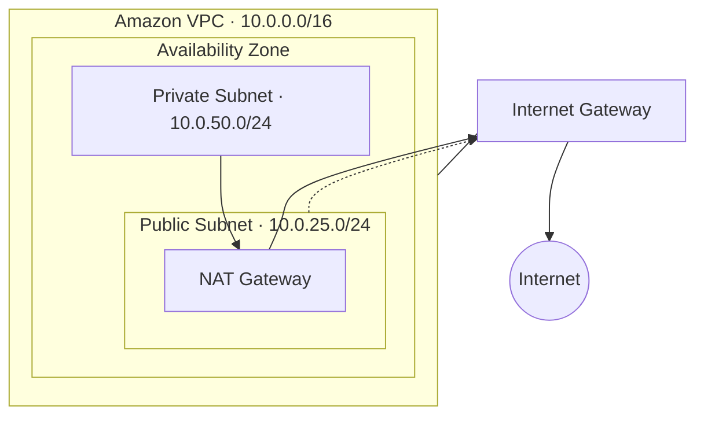

# AWS Lab 01 — Introduction to Amazon VPC

> AWS Builder Labs · SPL-84 · Version 2.0.22

**Status:** Completed  

## Overview

Created and explored a single Amazon VPC using the AWS VPC creation wizard, examining its subnets, routing, internet connectivity, and network security components.

## Configuration

| Setting | Configuration |
|---|---|
| VPC CIDR | `10.0.0.0/16` |
| Availability Zones | 1 |
| Public subnets | 1 (`10.0.25.0/24`) |
| Private subnets | 1 (`10.0.50.0/24`) |
| NAT Gateway | 1 (Zonal) |
| VPC Endpoints | None |

## Architecture

## Components Explored

- **Internet Gateway:** Provides internet connectivity to the VPC.
- **Public Subnet:** Uses a route to the Internet Gateway.
- **Private Subnet:** Uses the NAT Gateway for outbound internet connectivity.
- **Route Tables:** Direct traffic using local and default routes.
- **Network ACLs:** Stateless traffic filtering at the subnet level.
- **Security Groups:** Stateful traffic filtering at the resource level.

## Key Takeaways

- Public and private subnet classification depends on routing configuration.
- Internet Gateways and NAT Gateways serve different connectivity purposes.
- Network ACLs are stateless, while Security Groups are stateful.
- Security controls operate at different network levels.

No EC2 instances were deployed during this lab.

## References

- [Amazon VPC User Guide](https://docs.aws.amazon.com/vpc/latest/userguide/what-is-amazon-vpc.html)
- [NAT Gateways](https://docs.aws.amazon.com/vpc/latest/userguide/vpc-nat-gateway.html)
- [Network ACLs](https://docs.aws.amazon.com/vpc/latest/userguide/vpc-network-acls.html)
- [Security Groups](https://docs.aws.amazon.com/vpc/latest/userguide/vpc-security-groups.html)

---

[Back to AWS Cloud Practitioner Labs](../../README.md) · [Back to AWS](../../../README.md) · [Back to Cloud Labs](../../../../README.md)
