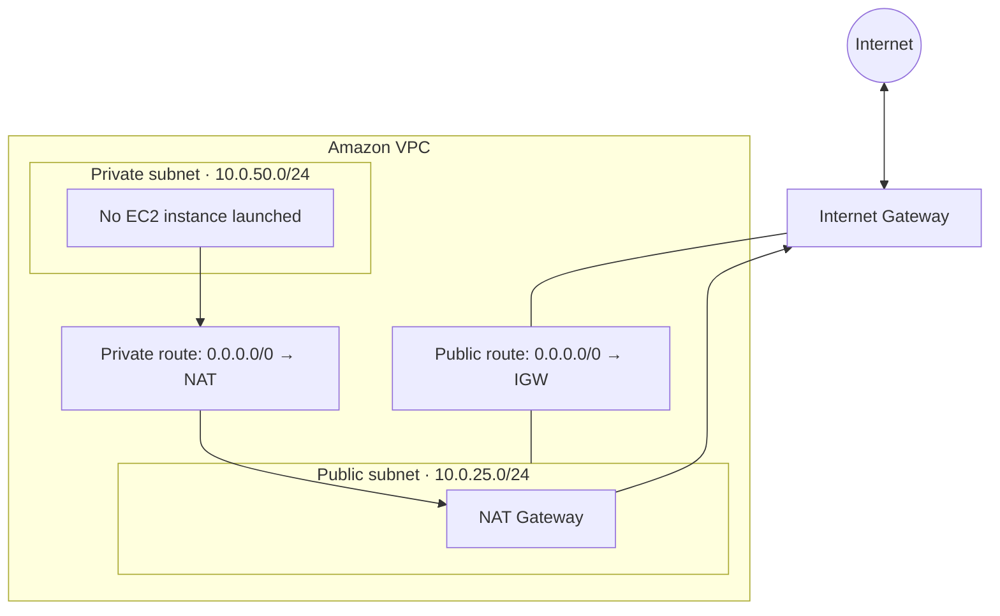

# AWS Lab 01 — Introduction to Amazon VPC

> AWS Builder Labs · SPL-84 · Version 2.0.22

**Status:** Not started
**Estimated duration:** 45 minutes

## Overview

This activity introduces Amazon Virtual Private Cloud (VPC) and its main networking components.

The exercise uses the VPC creation wizard to provision a virtual network with public and private subnets, then explores the routing and security components created by the wizard.

## Learning Objectives

- Create an Amazon VPC using the VPC creation wizard.
- Identify public and private subnets.
- Understand Internet Gateway and NAT Gateway roles.
- Inspect subnet route tables.
- Explore Network ACLs and Security Groups.
- Understand the difference between subnet-level and resource-level traffic controls.

## Planned Architecture

The activity creates one VPC with one Availability Zone, one public subnet, and one private subnet.

## Task 1 — Create an Amazon VPC

The VPC wizard is configured with the following parameters:

| Setting | Planned configuration |
|---|---|
| Creation option | VPC and more |
| Availability Zones | 1 |
| Public subnets | 1 |
| Private subnets | 1 |
| Public subnet CIDR | `10.0.25.0/24` |
| Private subnet CIDR | `10.0.50.0/24` |
| NAT Gateway placement | Zonal |
| NAT Gateways | 1 AZ |
| VPC Endpoints | None |

The VPC CIDR displayed by the wizard should be recorded after the activity is performed.

## Task 2 — Explore the VPC

Inspect the components created by the wizard.

### Internet Gateway

Connects the VPC to the internet. The public subnet uses a route to the Internet Gateway for internet-bound IPv4 traffic.

### Subnets

A subnet belongs to one VPC and one Availability Zone.

The activity uses one public subnet and one private subnet with distinct IPv4 CIDR ranges.

### Route Tables

The public subnet has a default route to the Internet Gateway.

The private subnet has a default route to the NAT Gateway. This permits resources in the private subnet to initiate outbound connections without a direct route to the Internet Gateway.

### Network ACLs

Network ACLs operate at the subnet level and are stateless. Both inbound and outbound traffic are evaluated against their respective rules.

### Security Groups

Security Groups operate at the resource/network-interface level and are stateful. Their rules control which inbound and outbound traffic is allowed.

## Observations and Evidence

To be completed after performing the activity.

- [ ] Record the VPC CIDR shown by the wizard.
- [ ] Inspect the public subnet route table.
- [ ] Inspect the private subnet route table.
- [ ] Compare Network ACL and Security Group behavior.
- [ ] Capture original screenshots with sensitive identifiers removed.
- [ ] Complete the knowledge check.

## Key Takeaways

To be completed after the lab, using personal observations and test results.

## Cleanup

When using AWS Builder Labs, follow the platform instructions to end the lab.

When reproducing the architecture in a personal AWS account, inspect and delete resources that are no longer needed. NAT Gateways and other provisioned services can generate charges.

## References

- [Amazon VPC User Guide](https://docs.aws.amazon.com/vpc/latest/userguide/what-is-amazon-vpc.html)
- [NAT Gateways](https://docs.aws.amazon.com/vpc/latest/userguide/vpc-nat-gateway.html)
- [Amazon VPC Pricing](https://aws.amazon.com/vpc/pricing/)

---

[Back to AWS Labs](../../README.md) · [Back to Cloud Labs](../../../README.md)
